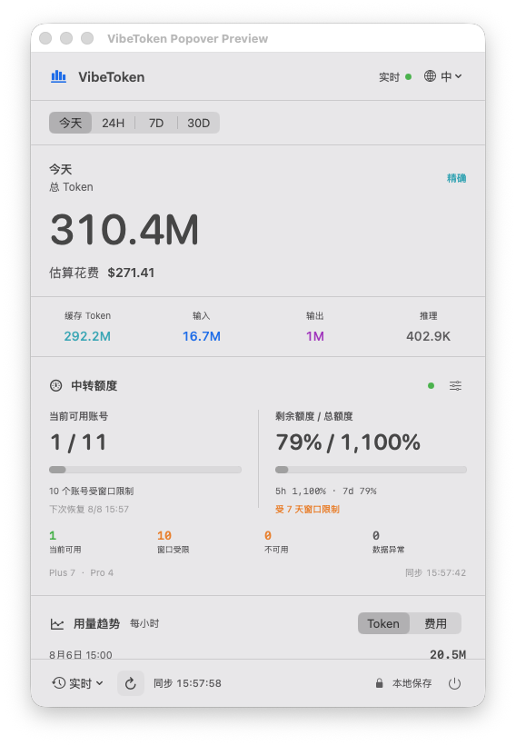

# VibeToken

<p align="center">
  
</p>

<p align="center">
  A local-first macOS menu bar app for tracking AI coding token usage, estimated cost, and relay account capacity.
</p>

<p align="center">
  <a href="README.zh-CN.md">简体中文</a>
  ·
  <a href="#install">Install</a>
  ·
  <a href="#privacy">Privacy</a>
</p>

<p align="center">
  
  
  
</p>

VibeToken is built for developers who use AI coding tools throughout the day and want one quick, honest view of local usage without opening multiple dashboards.

> [!NOTE]
> This is an early preview with twenty-two supported AI coding sources. The current release is [v0.1.10 Preview](https://github.com/AaAndrew233/VibeToken/releases/tag/v0.1.10). Downloadable builds are available from GitHub Releases, but they are not yet Apple-notarized.

## Preview

<p align="center">
  
</p>

## Features

- Automatic usage collection from 22 AI coding sources, with no simulated increments.
- Codex continues collecting active sessions by file modification time, including sessions whose date directory is older than the lookback window.
- Today, rolling 24-hour, 7-day, and 30-day totals and trends.
- Input, cache, output, reasoning, model, tool, and session breakdowns.
- Versioned OpenAI, Anthropic, and Google API price estimates with pricing coverage shown explicitly.
- Duplicate emission and fork/subagent replay filtering.
- Optional Sub2API pool monitoring with read-only automatic quota refreshes, per-account reset times and specific restriction reasons, and a separately confirmed manual OAuth credential refresh for updating plan metadata.
- Native macOS menu bar and Dock entry points in English and Simplified Chinese; Dock visibility and launch at login are managed only in the dedicated Settings window, which opens without dismissing the menu bar popover.

## Support

| Source | Status |
| --- | --- |
| Codex Desktop / CLI | Supported: live and archived sessions, including local profiles |
| Claude Code + Claude Desktop Code/Cowork | Supported: project logs, profiles, and Cowork session roots |
| Gemini CLI | Supported: current JSONL, legacy JSON, and nested subagent sessions |
| OpenCode | Supported: read-only SQLite with legacy JSON fallback |
| GitHub Copilot CLI | Supported: exact shutdown model metrics |
| Cursor | Supported: official account usage export, refreshed at most every 5 minutes |
| Cline | Supported: standalone and VS Code-family task logs with migrated-copy deduplication |
| Roo Code | Supported: VS Code-family task logs, including current and legacy indexes |
| Kiro CLI | Supported: native session logs; Token totals are explicitly estimated from observed text |
| Grok Build TUI / CLI | Supported: exact per-turn usage and per-model splits |
| DimAgent | Supported: read-only usage ledger with fork replay deduplication |
| OpenClaw | Supported: agent sessions, named profiles, and legacy data roots |
| pi | Supported: exact assistant-message usage, including cache reads and writes |
| Qwen Code | Supported: Gemini-style usage metadata with exclusive cache and reasoning categories |
| Kimi Code | Supported: current agent wires and legacy Kimi session stores |
| MiMoCode | Supported: read-only SQLite; imported external sessions are excluded |
| Amp | Supported: usage ledger with message-level fallback |
| Droid | Supported: exact cumulative totals; time distribution is derived from observed growth |
| Hermes | Supported: default and named-profile SQLite stores |
| Trae CLI | Supported: trace-level model usage with span deduplication |
| Antigravity | Supported: current offline protobuf databases and legacy local language-server fallback |
| ZCode | Supported: read-only message usage database |
| Sub2API Codex account pool | Supported, optional |

VibeToken does not infer exact token usage from ChatGPT or Claude desktop conversations. Subscription usage and API-priced cost are different things, so estimated cost is always labeled as an estimate.

## Install

The current GitHub Release build requires macOS 14+ on Apple silicon. On launch, VibeToken automatically discovers every supported source. There is no source setup, folder picker, or manual scan step. Missing tools are skipped without blocking the sources that are available.

### Install from GitHub Releases

1. Open the [latest release](https://github.com/AaAndrew233/VibeToken/releases/latest), then download the `macos-arm64` `VibeToken` archive and the checksum file.
2. Extract the archive and move `VibeToken.app` to Applications.
3. On first launch, Control-click the app in Finder and choose Open. This preview uses an ad-hoc signature and is not Apple-notarized, so macOS may show a security warning. Download builds only from this repository's Releases page.

### Build from source

Building from source also requires Xcode 16 or Swift 6 command-line tools:

```bash
git clone https://github.com/AaAndrew233/VibeToken.git
cd VibeToken
swift test
./scripts/build-app.sh
open "dist/VibeToken.app"
```

The build script creates an ad-hoc signed app at `dist/VibeToken.app`. It is suitable for local use, but it is not equivalent to a Developer ID signed and notarized release.

### Release status

- Current release: [v0.1.10 Preview](https://github.com/AaAndrew233/VibeToken/releases/tag/v0.1.10).
- For end-user distribution, use the versioned archive and checksum published on GitHub Releases. Do not share the entire development folder.
- The current archive is ad-hoc signed and not notarized, so another Mac may show a Gatekeeper warning.
- A public end-user release should use Developer ID signing, Apple notarization, and a versioned archive or DMG.

## Usage

1. Open VibeToken and click its menu bar item.
2. Choose Today, 24H, 7D, or 30D.
3. Select live, 5-minute, 30-minute, or manual refresh for local usage collection. Live mode reacts to file changes, coalesces burst writes, and uses a 60-second fallback scan if an event is missed. A connected Sub2API pool checks account membership every 30 seconds and performs a verified quota refresh every 30 minutes.
4. Click the gear button in the top-right of the menu bar popover to open Settings and control Dock visibility and launch at login. The popover remains open while Settings appears; these two options are not duplicated elsewhere in the popover.
5. Use the language control to switch between English and Simplified Chinese.

For optional Sub2API monitoring, sign in with an administrator account in the existing Relay Capacity area. Detected `Plus` accounts use 1x. The upstream values `prolite`, `pro`, and `promax` identify `Pro $100`, `Pro $200`, and `Pro $500`, including case, space, underscore, and hyphen variants; `chatgptpro` is recognized as `pro`. All three Pro tiers support plan confirmation and a separate optional estimated weight. Existing manual plan selections and `5x`, `10x`, and `20x` weights are preserved per server and account. Monthly prices never determine weights, and unknown plans never default to Plus. Individual quotas remain visible when a weight is unknown, while the cross-plan total shows `--`. If the initial refresh fails due to incomplete data, account configuration remains accessible; saving triggers a new verified quota refresh.

Choose **Skip** in an account's weight selector and save if its weight cannot be configured or it should not contribute to totals. The selection persists per server and account. Skipped accounts remain in the list and account counts, but are excluded from capacity totals, official quota probes, validation, and pool recovery estimates. Their missing quota data no longer blocks other accounts. The summary shows the skipped count; skipping every account leaves the total at `--`. To undo, select a weight or the unconfigured option in the same selector and save; normal configuration and quota validation requirements apply again. Skipping does not change server scheduling or exclude an account from separately confirmed OAuth credential updates.

App startup, Mac wake, account-pool changes, and the 30-minute schedule request Sub2API's official usage probe with `force=true` without changing OAuth credentials. When a connected user clicks refresh, VibeToken asks whether to refresh quotas only or update plan information and quotas. The latter explicitly calls Sub2API's batch OAuth credential refresh for active physical accounts, which can rotate stored account tokens and may take up to 120 seconds, then runs the verified quota refresh and reads the updated account list. On released servers without the batch usage route, VibeToken falls back to the per-account endpoint with `source=active&force=true` and at most six concurrent requests. The pool total is published only after all participating accounts pass validation. Partial credential or quota refreshes report the verified account count instead of publishing a false success. VibeToken does not reset or delete relay accounts.

## Accuracy

Token totals come from structured usage fields. Kiro CLI is the exception: its native session log has no Token counters, so VibeToken labels its text-based estimate accordingly. Cost is estimated from known model prices:

```text
estimated cost = input * input price
               + cache write * cache-write price
               + cache read * cache price
               + (output + reasoning) * output price
```

Unknown models remain unpriced instead of receiving a guessed fallback price. Historical usage is currently recalculated with the price catalog bundled in the installed app.

The bundled catalog records its verification date, effective dates, and official OpenAI, Anthropic, and Google source URLs. It includes GPT-6 Astra, GPT-6 Sol, GPT-6 Luna, the current GPT-5.6 family, and the GPT-5 Pro family prices. For GPT-6 and GPT-5.6 models, each usage event with more than 272K total input tokens uses the official long-context rate; shorter events use the short-context rate. Model identifiers ending in `-flex`, `-batch`, `-fast`, or `-priority` use the corresponding official processing-tier price. `priority` remains accepted as a compatibility alias for the current Fast mode name. A usage snapshot also selects time-limited pricing from its latest event timestamp; for example, Claude Sonnet 5 switches from its introductory price on September 1, 2026. A range that crosses a price-change boundary therefore remains an aggregate estimate rather than an invoice-grade event-by-event calculation. OpenCode reuses the matching provider price when its model identifier is recognized.

Cache writes use the official cache-write price when the model publishes one, otherwise they fall back to the normal input price for compatibility with older catalog entries. The current estimator does not calculate Gemini cache-storage time, regional-processing uplifts, subscription plans, free tiers, provider discounts, taxes, or tool-call charges. Token usage is still counted when a model has no matching bundled price; the UI marks the cost as partial or unavailable instead of inventing a rate.

Pricing sources: [OpenAI](https://developers.openai.com/api/docs/pricing/), [Anthropic](https://platform.claude.com/docs/en/about-claude/pricing), and [Google Gemini](https://ai.google.dev/gemini-api/docs/pricing).

For Sub2API, physical account counts remain unweighted. The availability card and plan summary show `currently available / schedulable total`, for example `Plus 7/8 · Pro 4/4`. The account quota sheet retains Available Accounts and Unavailable Accounts tabs with counts, defaulting to Available Accounts. Classification follows the server's enabled, scheduling, and runtime states. An enabled, schedulable account without a confirmed restriction stays available even when quota data is stale or missing; this does not guarantee that a request will succeed. Active rate limits, cooldowns, overloads, paused scheduling, disabled or errored accounts, and confirmed exhaustion in a valid quota window remain unavailable with specific reasons. Exhausted records whose reset time has passed await a refresh instead of proving continued unavailability or restored capacity; another window with valid exhaustion still blocks the account. Plan expiration display and field decoding have been removed because their freshness cannot be guaranteed. Plan expiration does not determine availability. Shadow accounts are excluded.

Following the [official OpenAI quota guidance](https://learn.chatgpt.com/docs/pricing) and [Sub2API plan mapping](https://github.com/Wei-Shaw/sub2api/blob/main/frontend/src/utils/planType.ts), checked November 11, 2026, recognized Pro tiers support weekly-only quotas without requiring manual plan selection first. When 5-hour data is absent or the window duration is explicitly zero, only the 7-day balance and reset time are displayed and verified; a non-applicable window is not shown as "5h 100%". A reported 300-minute window remains enforced. Legacy servers that report 5-hour usage without duration metadata retain that window. Unknown plans, missing weekly balances, unchanged timestamps, or malformed data are not treated as unlimited capacity. Account names and subscription expiration dates are not used to infer the tier.

Capacity uses the manually configured weights `Plus = 1`, `Pro 5x = 5`, `Pro 10x = 10`, and `Pro 20x = 20`. Totals involving manual Pro weights are labeled estimated, not official transferable quotas. Each window includes only active accounts to which that window applies; weekly-only Pro accounts are excluded from the 5-hour denominator. Dual-window accounts contribute their smaller remaining balance; weekly-only accounts contribute their weekly balance. Confirmed restrictions retain their weight but contribute zero. Stale or missing quota data on schedulable accounts, or an unknown weight on any active, non-skipped account, suppresses the total instead of presenting unknown capacity as zero. Reset times appear below valid balances, or `--` when absent. Pro accounts sort first, earlier recovery times first within each plan, and runtime-unavailable accounts last. Unknown quotas do not make an account invalid. The pool-level estimate remains the earliest reliably known complete recovery among non-skipped blocked accounts. Subscription quota settings do not change API token cost estimates.

## Privacy

- Only structured usage, model, project, session, and timestamp fields are extracted. Conversation content is never stored or sent.
- Source JSON/JSONL files and SQLite databases are opened read-only.
- Cursor is the only usage source that requires a provider request: VibeToken reads the existing Cursor access token from `state.vscdb` in memory and sends it only to `https://cursor.com` to fetch the official usage CSV. The token and response body are not persisted or logged.
- Legacy Antigravity `.pb` history is decoded only through its already-running language server on `127.0.0.1`; its CSRF token is kept in memory and never logged. Current Antigravity `.db` history is read offline.
- Usage indexes stay in the local application support directory.
- Tokens, passwords, cookies, account addresses, and response bodies are excluded from logs.
- Sub2API credentials are stored in local files with restricted permissions, not in macOS Keychain. This is less protected than Keychain against other processes running as the same macOS user.
- Automatic Sub2API monitoring is read-only. Only the explicitly confirmed **Update Plans & Quotas** action asks Sub2API to refresh OAuth credentials; this can rotate the relay accounts' stored access and refresh tokens.

## Development

VibeToken is an independent Swift implementation. It has no runtime dependency on another usage collector: each adapter reads the supported tool's structured local data or documented account export directly.

```bash
swift build
swift test
```

See [CONTRIBUTING.md](CONTRIBUTING.md) before changing a data source, usage formula, persistence model, or security boundary.

## License

[MIT](LICENSE)
