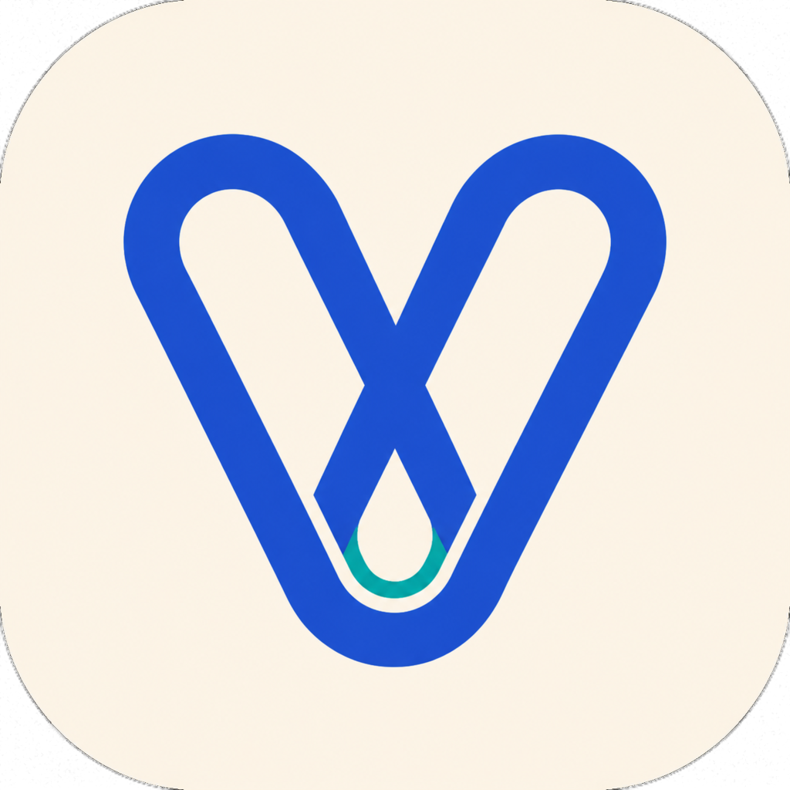
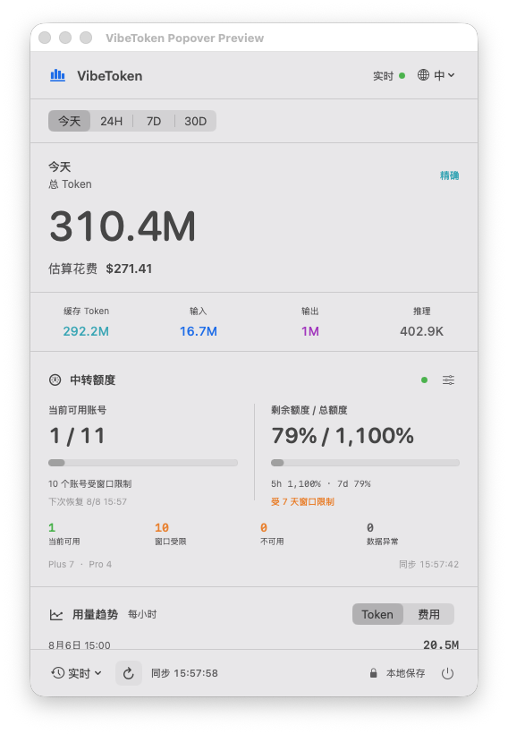

# VibeToken

<p align="center">
  
</p>

<p align="center">
  一个本地优先的 macOS 菜单栏应用，用于统计 AI 编程工具的 Token、预计费用和中转账号池额度。
</p>

<p align="center">
  <a href="README.md">English</a>
  ·
  <a href="#安装">安装</a>
  ·
  <a href="#隐私">隐私</a>
</p>

<p align="center">
  
  
  
</p>

VibeToken 面向高频使用 AI 编程工具的开发者，在一个菜单栏弹框中快速查看真实本地用量，不必反复打开多个后台页面。

> [!NOTE]
> 当前为早期预览版，已支持 22 个 AI 编程数据源。当前版本是 [v0.1.10 Preview](https://github.com/AaAndrew233/VibeToken/releases/tag/v0.1.10)。GitHub Releases 提供可下载安装包，但安装包尚未经过 Apple 公证。

## 界面预览

<p align="center">
  
</p>

## 核心功能

- 自动采集 22 个 AI 编程数据源的用量，不生成模拟增量。
- Codex 会按文件实际更新时间继续采集跨日期目录的活跃会话，避免长时间会话因目录日期过旧被漏计。
- 支持今天、滚动 24 小时、7 天和 30 天统计与趋势。
- 展示输入、缓存、输出、推理、模型、工具和会话分布。
- 使用带版本的 OpenAI、Anthropic 和 Google API 单价估算费用，并明确展示定价覆盖率。
- 过滤重复累计事件和 fork/subagent replay。
- 可选连接 Sub2API；自动额度刷新保持只读，展示账号额度、重置时间和具体受限原因，并提供需要单独确认的手动 OAuth 凭证刷新来更新套餐信息。
- 原生 macOS 菜单栏与程序坞入口，支持英文和简体中文；程序坞图标和开机自动启动仅在独立“设置”窗口中管理，打开设置时菜单栏弹框保持显示。

## 支持范围

| 数据源 | 状态 |
| --- | --- |
| Codex Desktop / CLI | 已支持：实时及归档会话，包含本地 profile |
| Claude Code + Claude Desktop Code/Cowork | 已支持：项目日志、profile 和 Cowork 会话目录 |
| Gemini CLI | 已支持：当前 JSONL、旧版 JSON 和嵌套子 Agent 会话 |
| OpenCode | 已支持：只读 SQLite，兼容旧版 JSON |
| GitHub Copilot CLI | 已支持：精确读取退出时的模型用量汇总 |
| Cursor | 已支持：读取官方账号用量导出，最多每 5 分钟请求一次 |
| Cline | 已支持：独立目录及 VS Code 系宿主任务日志，自动去除迁移副本 |
| Roo Code | 已支持：VS Code 系宿主任务日志，兼容当前及旧版索引 |
| Kiro CLI | 已支持：原生会话日志；Token 根据可观察文本明确标记为估算 |
| Grok Build TUI / CLI | 已支持：精确读取每轮用量及多模型拆分 |
| DimAgent | 已支持：只读用量账本，并去除 fork replay |
| OpenClaw | 已支持：Agent 会话、命名 profile 及旧版数据目录 |
| pi | 已支持：精确读取助手消息用量，包含缓存读取与写入 |
| Qwen Code | 已支持：Gemini 风格用量字段，拆分缓存与推理 Token |
| Kimi Code | 已支持：当前 Agent wire 及旧版 Kimi 会话目录 |
| MiMoCode | 已支持：只读 SQLite，并排除外部导入会话 |
| Amp | 已支持：优先读取 usage ledger，兼容消息级回退 |
| Droid | 已支持：累计总量准确，时间分布按观察到的增量推导 |
| Hermes | 已支持：默认及命名 profile 的 SQLite 数据库 |
| Trae CLI | 已支持：按 trace 读取模型用量并去除重复 span |
| Antigravity | 已支持：当前离线 protobuf 数据库及旧版本机语言服务回退 |
| ZCode | 已支持：只读消息用量数据库 |
| Sub2API Codex 账号池 | 已支持，可选 |

VibeToken 不会从 ChatGPT 或 Claude 桌面客户端的对话界面推断精确 Token。订阅用量与 API 单价费用不是同一口径，因此费用始终标记为预计值。

## 安装

当前 GitHub Release 安装包要求使用 Apple 芯片且运行 macOS 14+。VibeToken 启动后会自动发现所有已支持数据源，不需要配置数据源、选择目录或手动扫描。某个工具不存在时会自动跳过，不影响其他可用来源。

### 从 GitHub Releases 安装

1. 打开[最新版本](https://github.com/AaAndrew233/VibeToken/releases/latest)，下载 `macos-arm64` 的 `VibeToken` 压缩包和校验文件。
2. 解压后，将 `VibeToken.app` 移到“应用程序”文件夹。
3. 首次启动时，在 Finder 中右键点击应用并选择“打开”。当前预览版使用 ad-hoc 签名且未经过 Apple 公证，macOS 可能显示安全提示。请只从本仓库的 Releases 页面下载安装包。

### 从源码构建

从源码构建还需要 Xcode 16 或 Swift 6 命令行工具：

```bash
git clone https://github.com/AaAndrew233/VibeToken.git
cd VibeToken
swift test
./scripts/build-app.sh
open "dist/VibeToken.app"
```

构建脚本会在 `dist/VibeToken.app` 生成 ad-hoc 签名应用，适合本机使用，但不等同于经过 Developer ID 签名和 Apple 公证的正式安装包。

### 发布说明

- 当前版本：[v0.1.10 Preview](https://github.com/AaAndrew233/VibeToken/releases/tag/v0.1.10)。
- 面向用户分享时，使用 GitHub Releases 中的版本化安装包和校验文件，不要直接分享整个开发目录。
- 当前安装包使用 ad-hoc 签名且未经过 Apple 公证，其他 Mac 可能显示 Gatekeeper 安全提示。
- 面向普通用户正式发布时，应使用 Developer ID 签名、Apple 公证和带版本号的压缩包或 DMG。

## 使用

1. 打开 VibeToken，点击菜单栏项目。
2. 选择今天、24H、7D 或 30D。
3. 为本地用量采集选择实时、5 分钟、30 分钟或手动刷新。实时模式由文件变化触发，会合并连续写入，并以 60 秒兜底扫描处理可能漏掉的事件。连接后的 Sub2API 账号池每 30 秒检查账号变化，并且每 30 分钟执行一次带验真的正式额度刷新。
4. 点击菜单栏弹窗右上角的齿轮按钮打开“设置”，调整程序坞图标显示方式和开机自动启动；设置窗口出现时菜单栏弹框保持显示，这两个选项不再在弹框其他位置重复展示。

如需监控 Sub2API，在原有“中转额度”区域使用管理员账号登录。检测为 `Plus` 的账号固定按 1 倍计算；`prolite`、`pro`、`promax` 分别识别为 `Pro $100`、`Pro $200`、`Pro $500`，兼容大小写、空格、下划线及连字符，并将 `chatgptpro` 识别为 `pro`。三个 Pro 档位都支持套餐确认和独立选填的估算倍数。已有手动套餐选择及 `5x`、`10x`、`20x` 配置保留，按服务及账号分别保存。月费不用于推算额度倍数，未知套餐也不默认按 Plus 计算。权重未确认时单账号额度正常显示，跨套餐整池比例显示 `--`。首次刷新因数据不完整而失败时仍可进入账号额度配置，保存后会重新执行正式额度刷新。

无法配置权重或不需要参与汇总的账号，可在账号额度列表右侧选择“略过”并保存。选择按服务和账号持久保存；被略过账号保留在列表和数量统计中，但不参与额度汇总、正式额度探测、验真及池级恢复时间计算，也不会因缺失额度阻塞其他账号。总额度旁显示已略过数量；全部略过时仍显示 `--`。在同一下拉框重新选择权重或“请选择”并保存即可取消略过；恢复参与的账号仍需满足配置和额度验真要求。这一设置不改变后台调度状态，也不排除用户另行确认的 OAuth 凭证更新。

App 启动、Mac 唤醒、账号池变化以及每 30 分钟调度，都会以 `force=true` 请求 Sub2API 官方额度探测，但不会修改 OAuth 凭证。连接 Sub2API 后手动点击刷新时，VibeToken 会询问“仅刷新额度”还是“更新套餐与额度”；后者会明确调用 Sub2API 的批量 OAuth 凭证刷新，只处理 active 实体账号，可能轮换服务端保存的 Token，最长等待 120 秒，之后再执行正式额度刷新并回读账号列表。对于没有批量额度路由的正式版服务，会回退到 `source=active&force=true` 的单账号接口，并发最多 6 个请求。只有参与汇总的账号全部验真通过才发布总额度；套餐或额度部分刷新失败时只报告已验证账号数，不会误报全部成功。VibeToken 不会重置或删除中转账号。

## 统计口径

Token 来自结构化用量字段。Kiro CLI 是例外：其原生会话日志没有 Token 计数，因此 VibeToken 会明确标记按文本估算的结果。费用按已知模型价格估算：

```text
预计费用 = 输入 * 输入单价
         + 缓存写入 * 缓存写入单价
         + 缓存读取 * 缓存单价
         +（输出 + 推理）* 输出单价
```

未知模型不会套用猜测价格。历史用量目前按已安装版本内置的价格目录回算。

内置价格目录会记录核对日期、生效日期和 OpenAI、Anthropic、Google 官方来源地址，并包含 GPT-6 Astra、GPT-6 Sol、GPT-6 Luna、最新 GPT-5.6 系列和 GPT-5 Pro 系列价格。对于 GPT-6 和 GPT-5.6，每条用量事件的总输入 Token 超过 272K 时采用官方长上下文价格，否则采用短上下文价格；模型标识以 `-flex`、`-batch`、`-fast` 或 `-priority` 结尾时采用对应的官方处理档位价格，其中 `priority` 作为当前 Fast 模式名称的兼容别名保留。用量快照也会按其中最近一条事件的时间选择限时价格，例如 Claude Sonnet 5 会在 2026 年 9 月 1 日结束首发价格；跨越价格切换日的统计区间仍是聚合估算，不是逐事件账单。OpenCode 的模型标识能够识别时，会自动复用对应供应商的价格。

模型提供独立缓存写入价格时按官方缓存写入价格计算，旧价格条目没有该字段时回退到普通输入价格。当前仍不计算 Gemini 缓存存储时长、区域处理加价、订阅套餐、免费额度、供应商折扣、税费和工具调用费用。模型没有匹配到内置价格时，Token 仍会正常统计，界面会明确显示费用覆盖不完整或暂无定价，不会虚构单价。

价格来源：[OpenAI](https://developers.openai.com/api/docs/pricing/)、[Anthropic](https://platform.claude.com/docs/en/about-claude/pricing)、[Google Gemini](https://ai.google.dev/gemini-api/docs/pricing)。

Sub2API 的账号数量按真实实体账号统计；可用账号卡片和套餐汇总显示“当前可用数 / 可调度账号总数”，例如 `Plus 7/8 · Pro 4/4`。账号额度弹窗保留“可用账号”和“不可用账号”两个 Tab，默认显示可用账号并标注数量。分类以后台启用、调度及运行限制为依据；后台允许调度且没有有效限制证据的账号归入可用。额度数据过期或缺失只表示额度待更新，不再单独导致账号不可用；这一分类不保证实际请求一定成功。仍有效的限流、临时冷却、过载、后台暂停调度、停用或异常，以及有效窗口内已确认的额度耗尽，继续归入不可用并显示具体原因。已过重置时间的旧耗尽记录等待刷新，不推断额度已恢复；另一窗口仍有效的耗尽记录仍会阻止账号可用。套餐到期时间因无法保证及时更新，已移除显示及字段读取，不参与分类。影子账号不重复计数。

依据 [OpenAI 官方额度说明](https://learn.chatgpt.com/docs/pricing)及 [Sub2API 套餐映射](https://github.com/Wei-Shaw/sub2api/blob/main/frontend/src/utils/planType.ts)（2026-11-11 核对），已识别的 Pro 档位支持仅周额度，无需先手动选择套餐。服务端没有返回 5h 数据，或窗口时长明确为零时，只显示和校验 7d 额度及重置时间，不把非适用窗口显示为“5h 100%”。仍报告真实 300 分钟窗口时继续校验其限制；旧接口未提供时长但返回了 5h 用量时，保留该窗口。未知套餐、周额度缺失、时间戳未更新或数据格式错误不会被解释为无限额度。套餐到期时间和账号名称均不用于推断档位。

额度容量按手动确认的 `Plus = 1`、`Pro 5x = 5`、`Pro 10x = 10`、`Pro 20x = 20` 加权；包含手动 Pro 权重时标为“估算”，不是官方可兑换额度。各窗口只汇总适用该窗口的 active 账号，只有周额度的 Pro 不进入 5h 分母。双窗口账号贡献两者较小值，单周账号贡献周剩余额度；有明确限制的账号保留权重但贡献零。可调度账号的数据过期、未探测或未略过的 active 账号权重未知时，不显示整池比例，避免把未知当成零。有效额度对应的重置时间显示在下方，未提供时显示 `--`。排序时 Pro 优先，同套餐内恢复时间早的优先，后台不可用账号置底；额度待更新不等于账号失效。池级预计恢复仍取未略过的受限账号中最早且可确认的完整恢复时间。上述订阅额度配置不改变 API Token 费用统计。

## 隐私

- 只提取结构化用量、模型、项目、会话和时间字段；对话正文不会保存或发送。
- 各工具的 JSON/JSONL 文件和 SQLite 数据库均以只读方式访问。
- Cursor 是唯一需要访问供应商接口的用量数据源：VibeToken 仅在内存中读取 `state.vscdb` 现有 Cursor 访问令牌，并只发送到 `https://cursor.com` 获取官方用量 CSV；令牌和响应正文不会持久化或写入日志。
- 旧版 Antigravity `.pb` 历史只通过其已运行的 `127.0.0.1` 本机语言服务解码；CSRF Token 仅在内存中使用且不会写入日志。当前 Antigravity `.db` 历史直接离线只读。
- 用量索引保存在本机应用支持目录。
- 日志不记录 Token、密码、Cookie、账号地址或响应正文。
- Sub2API 登录信息保存在受限权限的本地文件中，不使用 macOS Keychain。与 Keychain 相比，同一 macOS 用户权限下的其他进程更容易读取这些文件。
- Sub2API 自动监控保持只读；只有用户明确确认“更新套餐与额度”后才会请求 Sub2API 刷新 OAuth 凭证，这可能轮换中转账号在服务端保存的 Access Token 和 Refresh Token。

## 开发

VibeToken 是独立的 Swift 实现，运行时不依赖其他用量统计工具；每个适配器直接读取对应工具的结构化本地数据或公开账号用量导出。

```bash
swift build
swift test
```

修改数据源、统计公式、持久化结构或安全边界前，请先阅读 [CONTRIBUTING.md](CONTRIBUTING.md)。

## 许可证

[MIT](LICENSE)
